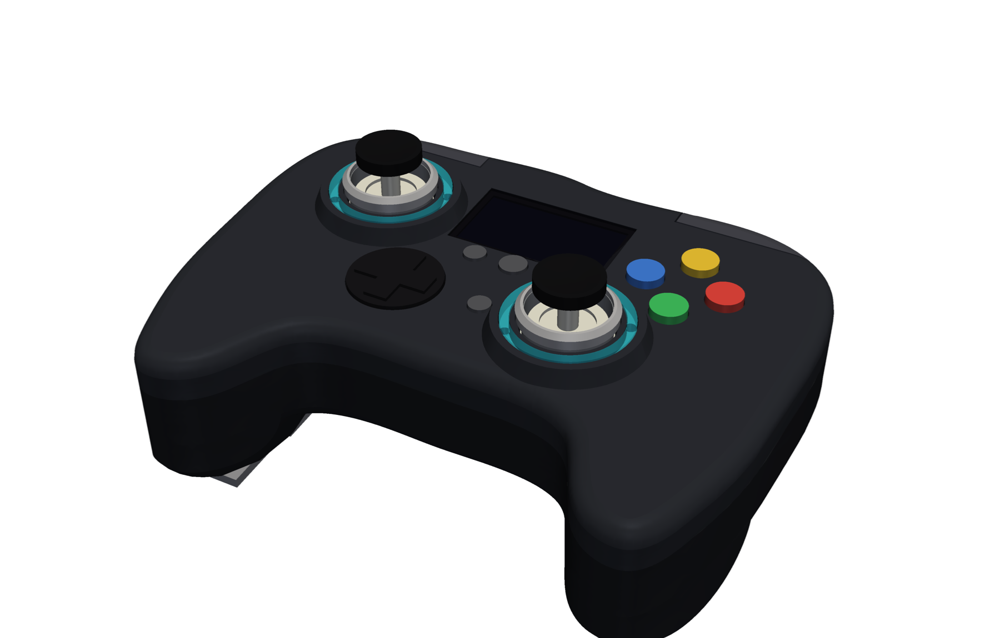
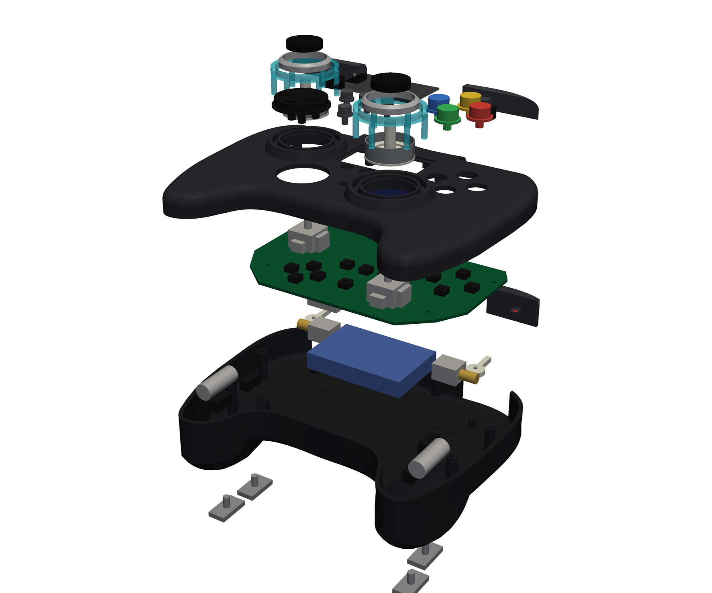
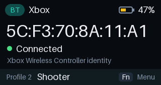
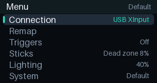
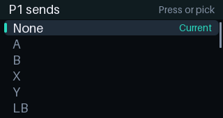

# Kestrel

Kestrel is a design for a game controller that works with PC, Android, iPhone, and iPad. This repository holds the electronics, the enclosure, and the firmware.

Status: design files only. Nobody has built or tested a Kestrel. Every part of the design needs a prototype before it can be trusted.

## What the design covers

| Requirement | How the design answers it |
| --- | --- |
| USB-C, Bluetooth, WiFi | ESP32-S3 module with native USB, Bluetooth LE, and WiFi |
| Remote play over WiFi | The pad sends inputs straight to a receiver on the gaming PC |
| Xbox layout | Offset sticks, ABXY, D-pad, View, Menu, Home, bumpers, triggers |
| TMR sticks with a tension ring | TMR modules in the ALPS footprint. A ring under each stick preloads an added centring spring |
| Adaptive triggers | A motor, worm, and stop arm per trigger, with Hall position sensing |
| Tactile LB and RB | Micro switches |
| Four back paddles | Two per grip on micro switches, remappable |
| Backlit controls | 24 addressable RGB LEDs under translucent buttons and stick rings |
| Screen | 1.9 inch 320 x 170 display showing host, battery, and profile, with on-device remapping |
| XInput and DInput | Both over USB. Bluetooth offers an Xbox identity and a generic gamepad |
| Wider grip | 173 mm wide body with full grips |

`docs/spec.md` explains each decision.

## Layout

| Folder | Contents | Start with |
| --- | --- | --- |
| `docs/` | Specification and WiFi protocol | `docs/spec.md` |
| `shared/` | Coordinates and pin assignments that the other folders read | `layout.json`, `pinmap.json` |
| `hardware/` | KiCad schematic and PCB, generator scripts, fabrication files | `hardware/README.md` |
| `mech/` | Enclosure and mechanism CAD, STEP and STL files, renders | `mech/README.md` |
| `firmware/` | ESP-IDF firmware, native tests, screen simulator | `firmware/README.md` |
| `host/` | PC receiver for WiFi mode | `host/README.md` |

## What has been checked

| Area | Checked | Not checked |
| --- | --- | --- |
| Schematic | KiCad electrical rules check | Review by a second engineer |
| PCB | KiCad design rules check and schematic parity. Results are in `hardware/README.md` | Fabrication, assembly, power-up |
| Enclosure | Part interference, stick tilt clearance, trigger sweep, opening positions | Printing, fit, strength, feel |
| Firmware | Builds for the ESP32-S3. 49 unit tests pass on a PC. The screen UI renders in a simulator | Anything on hardware |
| WiFi receiver | 23 tests pass against a simulated pad | The virtual gamepad driver |

The screen UI below comes from the real firmware code running in the simulator.

  

## Biggest risks

1. **iPhone and iPad.** iOS only accepts known controllers. The firmware presents an Xbox controller's Bluetooth identity, and nobody has confirmed that this works from an ESP32. Treat Apple support as unproven.
2. **The PCB is autorouted.** It passes the rule checks, but the router ran signal tracks through the inner power layers. A layout engineer should review it before a production order. See `hardware/README.md`.
3. **The stick tension mechanism is new.** Its forces are calculated, not measured, and it may make L3 and R3 click too easily on the tightest setting.
4. **The trigger actuator is first-pass.** The gear ratio, motor, and arm geometry need tuning on a prototype.
5. **Parts need checking against their drawings.** The thumbstick module's supply pins, the micro switch footprint, the fuel gauge footprint, and the display module's pocket are listed in `docs/spec.md` under open items.

## Building a prototype

1. Read the open items in `docs/spec.md` and the "Before ordering" list in `hardware/README.md`.
2. Order the PCB from `hardware/out/fab/` and the parts in `hardware/out/kestrel-bom.csv`.
3. Print the parts in `mech/out/stl/`.
4. Build and flash the firmware as `firmware/README.md` describes.
5. Run stick, trigger, and bumper calibration from the on-screen menu.

## Third-party material

- The schematic and PCB embed symbols and footprints from the KiCad libraries, which use the CC-BY-SA 4.0 licence with an exception for designs.
- `hardware/lib/easyeda/` holds the thumbstick symbol, footprint, and 3D model converted from the EasyEDA library entry for LCSC part C146170. Check EasyEDA's terms before publishing them.
- The firmware font is generated from Aileron, a CC0 typeface.
- The Xbox-identity Bluetooth mode uses Microsoft's vendor ID and report format. That suits a personal prototype and is not cleared for a product on sale. The USB vendor ID `1209:0001` is a placeholder.
