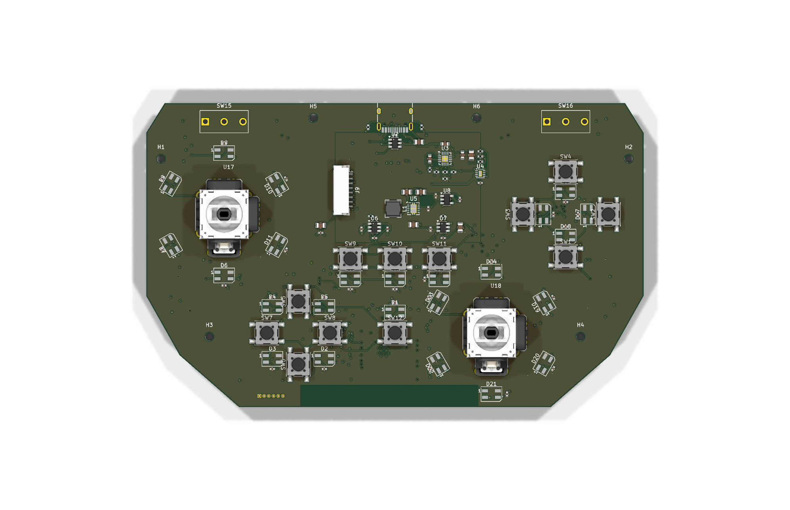
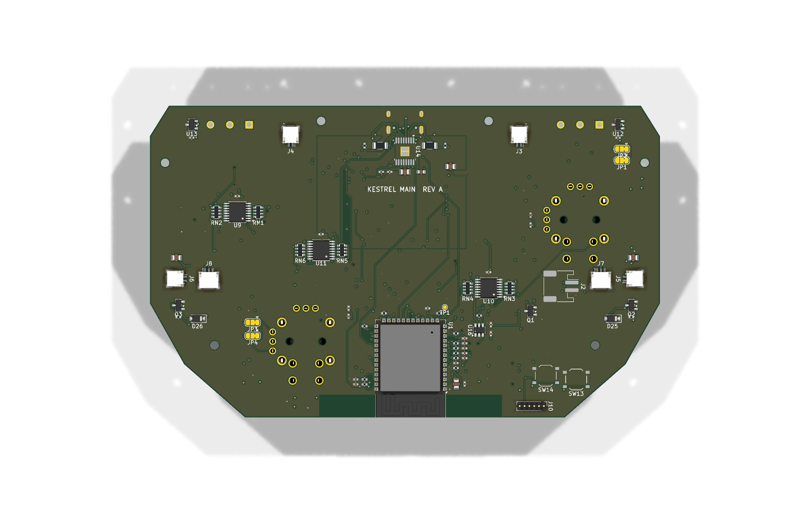

# Kestrel main board

One four-layer PCB, 134 x 82 mm, carrying everything except the display module, battery, motors, and paddle switches. Scripts generate the schematic, the board, and the fabrication files from `gen/design.py`.

Status: generated and rule-checked. Nobody has fabricated or powered this board. Read "Before ordering" below.





## Files

| Path | Contents |
| --- | --- |
| `kestrel.kicad_pro`, `kestrel.kicad_sch`, `kestrel.kicad_pcb` | KiCad 10 project |
| `gen/` | Generator scripts. `design.py` holds the parts, nets, and placement |
| `lib/` | Project libraries: the fuel gauge symbol, the micro switch footprint, and the thumbstick part from EasyEDA |
| `out/kestrel-schematic.pdf` | Schematic |
| `out/kestrel-bom.csv` | Bill of materials, 47 lines |
| `out/fab/` | Gerbers, drill files, and the position file |
| `out/kestrel-pcb.step` | 3D model of the assembled board |
| `out/erc.json`, `out/drc.json` | Rule check reports |

## Checks

Results from the last run:

| Check | Result |
| --- | --- |
| Electrical rules check on the schematic | 0 violations. 190 symbols, 130 nets |
| Design rules check on the board | 0 errors, 102 warnings. Every warning is silkscreen text over copper, over other text, or near the edge |
| Unconnected items | 0 |
| Schematic parity (board nets and footprints against the schematic) | 0 differences |

The board has 193 footprints, 2481 track segments totalling 6.2 m, and 353 vias.

The rule set: 0.2 mm tracks and 0.15 mm clearance by default, 0.4 mm for power nets, 0.6 mm vias with 0.3 mm holes, 0.3 mm copper-to-edge. The autorouter narrows a few tracks to 0.1 mm at fine-pitch pins, so the minimum track width is 0.1 mm. These fit a standard four-layer service such as JLCPCB's. Confirm against your fabricator's limits.

## Layers

| Layer | Use |
| --- | --- |
| F.Cu | Face-side parts, signals, a VLED pour, and a VSYS pour over the power section |
| In1.Cu | Ground plane, with signal tracks through it |
| In2.Cu | VLED plane, with signal tracks through it |
| B.Cu | Battery-side parts, signals, a ground pour, and a VSYS pour |

VLED is the switched rail that feeds the LEDs and rumble motors. VSYS is the charger's system output.

The autorouter put 3.9 m of the 6.2 m of track on the two inner layers. Those tracks cut both planes into pieces. The finish stage joins the pieces again: each rail has copper on a second layer, and vias tie every island of one layer to the other. The board is fully connected, but neither inner layer is a solid plane. This is the board's main weakness. Before a production order, a layout engineer should move the signals off In1 so the ground plane is unbroken.

## Where things are

Face side: both thumbsticks, twelve tact switches, 24 LEDs with their capacitors, the LB and RB micro switches, the USB-C socket, the display connector, and the power section (charger, buck-boost, fuel gauge, load switches, 3.0 V regulator) under the display.

Battery side: the ESP32-S3 module with its antenna over the rear edge, three shift registers with pull-up arrays, the trigger motor driver, the Hall sensors, the rumble drivers, and the connectors.

| Connector | Type | Pins |
| --- | --- | --- |
| J1 | USB-C | USB 2.0 |
| J2 | JST-PH 2 | 1 battery +, 2 ground |
| J3, J4 | JST-SH 2 | Left and right trigger motors |
| J5, J6 | JST-SH 2 | Left and right rumble motors: 1 VLED, 2 switched return |
| J7, J8 | JST-SH 3 | Paddle switches: two inputs and ground |
| J9 | JST-GH 8 | Display module: VCC, GND, DIN, CLK, CS, DC, RST, BL |
| J10 | 1.27 mm header | 3V3, GND, UART TX, UART RX, EN, BOOT |

JP1 to JP4 are three-pad solder jumpers that set which outer pin of each thumbstick axis gets 3.0 V and which gets ground. They ship bridged for 3.0 V on pads 3 and 4.

SW13 is BOOT and SW14 is RESET. The bottom shell has a pinhole over each.

## Regenerating

The scripts need KiCad 10, Java 21 or later, and the Freerouting jar. Set `KICAD_ROOT` and `FREEROUTING_JAR` if they are not in the default locations at the top of `gen/build.py`. Run with KiCad's own Python:

```powershell
cd hardware\gen
$py = "$env:KICAD_ROOT\bin\python.exe"
& $py build.py sch       # schematic, ERC, PDF, netlist
& $py build.py pcb       # placed board, placement DRC, autorouter input
& $py build.py route     # autoroute (about 25 minutes), then the finish stage
& $py build.py outputs   # Gerbers, drill, position, BOM, STEP, renders
```

`build.py finish` repeats the finish stage on the saved autorouter session: it rebuilds the placed board, imports the routes, adds the pours, joins the copper islands, routes any stranded pad to its rail, and runs DRC.

The autorouter gives a different result on every run. A new run can leave a pin stranded that the finish stage cannot reach. Check that DRC reports 0 unconnected items before using the output.

`build.py route3` is an experiment that keeps In1 as a solid ground plane. It left about 40 signal connections unrouted, so the delivered board does not use it.

## Before ordering

1. **Thumbstick supply pins.** Find which outer pin of each axis is the supply on your TMR module and set JP1 to JP4 before first power-up. A reversed supply may damage the module.
2. **Thumbstick footprint.** It is the ALPS RKJXV1224005 footprint from EasyEDA. Check it against your module.
3. **Micro switch footprint.** `SW_D2FC_THT` is drawn from the usual D2FC dimensions: three pins at 5.08 mm in a 12.8 x 5.8 mm body. Check it against your switch.
4. **Fuel gauge footprint.** The MAX17048 uses KiCad's generic 2 x 2 mm DFN-8. Check the pad sizes against the datasheet.
5. **Display cable.** J9 follows the Waveshare 1.9inch LCD Module's pin order. Check the order on your module and cable.
6. **Layout review.** See "Layers". Also check the 0.4 mm power tracks against your current needs. The USB data pair is not length-matched or impedance-controlled, which full-speed USB tolerates.
7. **Parts.** Nobody has checked the BOM for stock, price, or alternates. Passive voltage ratings are given only where they matter.
8. **Charging.** The input limit is 500 mA. The TS pin has a fixed 10k resistor, so the charger does not monitor battery temperature.
