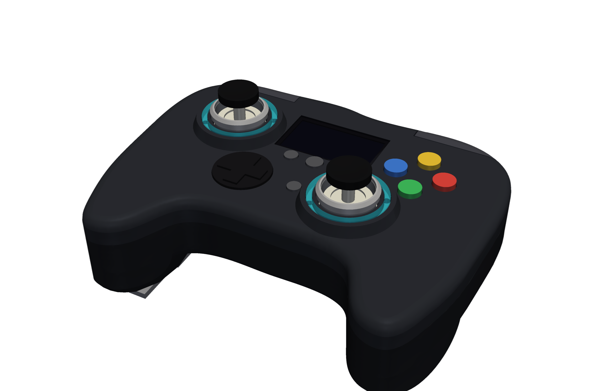
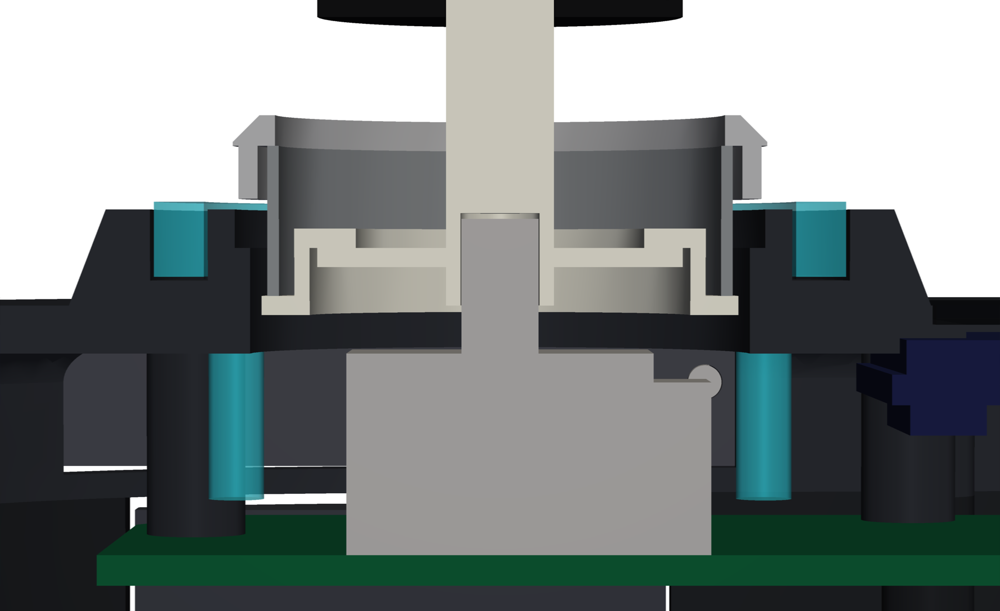
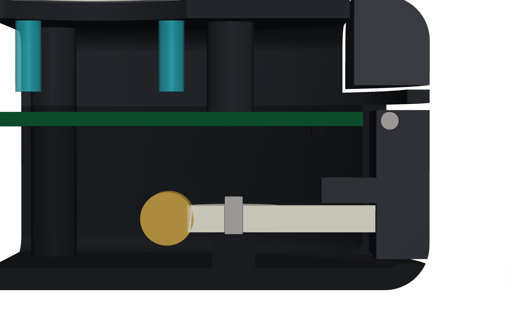

# Kestrel enclosure and mechanisms

First-pass CAD for the Kestrel controller: two shell halves, the buttons, the stick tension mechanism, the adaptive trigger actuators, and the back paddles. One CadQuery script builds every part from `shared/layout.json`.

Status: nothing here has been printed or assembled. The model passes the geometric checks below. Fit, feel, and strength need a prototype.



## Files

| Path | Contents |
| --- | --- |
| `src/kestrel_cad.py` | The parametric model, the checks, the exports, and the renders |
| `out/step/` | One STEP file per part and `kestrel_assembly.step` |
| `out/stl/` | STL files for the 31 printed parts |
| `out/kestrel_assembly.glb` | The coloured assembly |
| `out/viewer.html` | A standalone 3D viewer. Open it in a browser. It loads three.js from a CDN |
| `out/renders/` | Seven PNG views |
| `out/checks.json` | Results of the checks |

## Rebuild

```powershell
cd mech
py -3.12 -m venv .venv
.venv\Scripts\python -m pip install cadquery trimesh pyvista
.venv\Scripts\python src\kestrel_cad.py
```

A full run takes about a minute. `--quick` skips the checks and exports and only renders.

## Size

The body is 173 mm wide and 131 mm deep. It is 33 mm thick at the centre and 55 mm at the grips. With the sticks the height is 74 mm.

## Parts

Printed parts, 31 in total:

- top shell and bottom shell
- per stick: cap, stem with centring disc, plunger, tension ring, glow ring
- A, B, X, Y, D-pad, View, Home, Menu, Fn
- two bumpers, two triggers, two trigger stop arms
- four paddles

Purchased parts that the model places as simple shapes: the PCB, battery, display module, thumbstick modules, tact switches, micro switches, trigger motors, worms, rumble motors, magnets, springs, and 2 mm steel pins. The display lens is 1 mm acrylic, laser cut to 46.6 x 27.0 mm.

Suggested materials: ABS, PETG, or nylon for the shells; clear resin for the glow rings and button caps; POM or tough resin for the stem, disc, and plunger; resin for the stop arm, bonded to a purchased 20-tooth module 0.5 worm wheel.

## Stick tension



A disc on the stick stem sits under a cup-shaped plunger. A spring between the plunger and the tension ring presses the plunger onto the disc. Tilting the stick lifts the plunger, so the spring adds to the module's own centring force. Turning the ring moves the spring seat 2 mm.

| Ring position | Spring length | Spring force | Added force at the cap |
| --- | --- | --- | --- |
| Loosest | 8.8 mm | 0.26 N | 10 gf |
| Middle | 7.8 mm | 0.73 N | 28 gf |
| Tightest | 6.8 mm | 1.20 N | 46 gf |

The spring is 23.6 mm mean diameter, 0.5 mm wire, 9.35 mm free length, 0.47 N/mm. These forces are calculated from the geometry, not measured. Friction between the disc and plunger is ignored.

At full tilt the plunger lifts 4.5 mm. On the tightest setting that leaves the spring 2.3 mm long, close to its solid height, with 3.3 N on the stem. That may be enough to click L3 or R3 by accident. Check this first on a prototype.

The glow ring sits in a groove around the tension ring. Six posts carry light up from the LEDs on the PCB.

## Adaptive triggers



Each trigger pivots on a 2 mm pin at the top of the blade and travels 22 degrees. An arm behind the pivot carries a 3 x 3 x 2 mm magnet. The magnet rises toward the Hall sensor on the PCB as the trigger is pulled and ends about 2 mm below it.

The motor lies along X with a worm on its outboard end. The worm turns a 20-tooth wheel that carries the stop arm. With the arm straight back it meets the rear of the blade and blocks the pull. Swung 56 degrees inboard it clears the blade for the full travel. Positions in between set where the trigger stops.

## Checks

`kestrel_cad.py` runs these and writes the results to `out/checks.json`. Results from the last run:

| Check | Result |
| --- | --- |
| Shell openings over the sticks, buttons, D-pad, and display positions in `layout.json` | All 12 open |
| Interference between every pair of the 64 parts | No pair overlaps by more than 0.05 mm3 |
| Each stick tilted 25 degrees in eight directions, ring at its loosest | No contact with the shell, glow ring, tension ring, or module body |
| Each trigger pulled 22 degrees | No contact with the shells, PCB, battery, motor, bumper, or parked stop arm |
| Stop arm in the blocking position | Blocks the pull |
| Magnet position at full pull | 2.0 mm below the Hall sensor, centred |

The interference check skips pairs that are meant to touch: pins in their holes, the stem on the module shaft, the cap on the stem, the magnet in its pocket, the motor on its pad, and the worm against the wheel.

The purchased parts are simple boxes and cylinders. The thumbstick module's shape above the PCB is an estimate, so the stick clearances depend on the real module.

## Not modelled yet

- The tension ring's three-start ramp and detents. The ring is a plain collar at the middle of its travel.
- Bumper hinge ears, trigger pivot bosses, and return springs.
- An alignment lip between the shell halves. Six screws join them.
- Retention for the display module, battery, rumble motors, and trigger motors.
- Light barriers between neighbouring LEDs.
- Legends on the buttons.

## Known problems

- The turret wall between the tension ring and the glow ring is 1.4 mm thick, under the 1.6 mm target.
- The ledge that carries the display lens is 0.7 mm thick.
- The stick caps stand 19 mm above the face, taller than a standard pad, because the tension mechanism sits under them. The caps are plain discs.
- The paddles are flat plates in recesses on a curved grip.
- The STL files are in assembly orientation. Choose the print orientation in the slicer.
- The display pocket uses the Waveshare module's outline and an assumed thickness. Check it against the module drawing.
